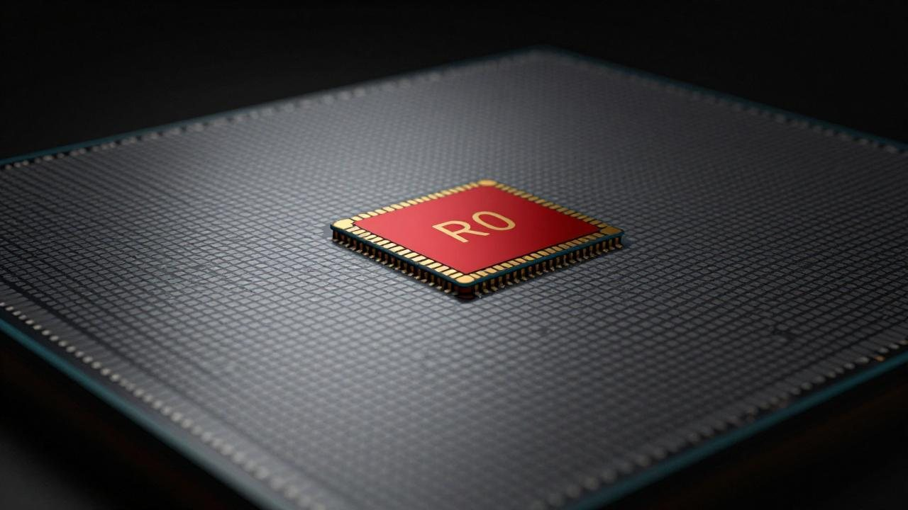

<p align="center">
  
</p>

<h1 align="center">ringzero</h1>

<p align="center">
  <b>An operating system where the AI is part of the kernel.</b><br>
  <a href="https://tcsenpai.github.io/ringzero-site/">Website</a> ·
  <a href="docs/DEMOS.md">Demos</a> ·
  <a href="INFO.md">Technical notes</a> ·
  <a href="docs/ARCHITECTURE.md">Architecture</a> ·
  <a href="docs/ROADMAP.md">Roadmap</a>
</p>

<p align="center">
  
</p>


ringzero boots on bare x86-64 (no Linux underneath) and runs two models in ring 0, next to the scheduler
and the drivers, on one shared inference engine:

- a **language model** (Qwen3.5) that you talk to at the shell: it answers, reads and writes your files and
  runs programs;
- an **embedding model** (Qwen3-Embedding-0.6B) that gives the system a semantic memory: it indexes your
  notes, your files and your past conversations, so the OS can find things by meaning, not by file name.

Together they make an OS that understands what you ask and remembers you across reboots. It is an
experiment: the question is what an OS looks like when the models are not apps on top of it, but parts of it.

```
ringzero[main]> count the lines of /demo/stats.py with wc
[tool] run_wasm(path=wc, args=-l /demo/stats.py)
[tool] -> 24 /demo/stats.py
[exit 0]
```

## What it does

- **Talk to the machine.** Plain text goes to the system agent, which calls typed kernel tools: files,
  memory, CPU cores, logs, settings, power. Anything that deletes or powers off asks you first.
- **Semantic memory, built in.** The embedding model indexes every text file you write and every session, in
  the background while you are idle, into an index saved on the disk. "what do I need to buy?" finds the
  shopping list you wrote last week. `/search` queries it directly.
- **It remembers you.** Facts you tell it ("my name is Anna") and summaries of past sessions are kept on the
  disk and come back after a reboot. The kernel, not the model, decides what goes into the model's context,
  so the memory stays small and on topic.
- **It knows its own manual.** "how do I hibernate?" is answered from the built-in manual, which the
  kernel indexes (its vectors are built into the kernel) and puts in front of the question; `/man TOPIC`
  searches it directly.
- **Undo for the AI.** Every turn is a snapshot of the model's state: `/undo`, `/redo`, `/retry`, named
  branches, save and load. Going back takes about 1.5 ms on the 4B.
- **Hibernate and resume.** Power off and the whole conversation, with its history tree, is written to disk.
  The next boot picks it up exactly where it was, checked by a state hash.
- **Tool calls that cannot break.** While the model writes a tool call, the kernel only lets through tokens
  that keep it valid against the tool's schema. In the tests: zero malformed calls.
- **Unsure calls ask first.** Each tool call shows how sure the model was; unsure ones that write (a file, a folder, a setting, a fact) ask.
- **Real software.** python3 (CPython 3.15), sqlite3, jq, Lua, QuickJS, ripgrep, the coreutils and a text
  editor run from `/bin` in a WASI sandbox, from the shell and for the agent. MicroPython is built in for quick
  one-liners (`!py 17*23`).
- **A Unix-like file tree.** `/proc` (cpuinfo, meminfo, uptime, devices, kmsg), `/sys` (disk, PCI devices, cores,
  `power/state`), `/dev` (null, zero, urandom, the disk), `/etc` (hostname, os-release) and `/tmp` work the same
  from the shell, for the agent and for programs; `echo disk > /sys/power/state` hibernates. ringzero's own data
  lives in `/var/lib/ringzero`, out of the agent's reach.
- **Fast where it matters.** The prompt is read in blocks (about 230 tokens/s on the 2B), the boot state is
  cached on disk, and the system does its housekeeping (indexing, summarizing) while you are idle. When the
  answer copies text from the conversation (a file, a tool result), it is written about 2.5x faster, and tool
  calls about 1.8x faster (the format's own text is drafted from the grammar), with the same output. The
  session summary runs as a second stream in the same engine passes as your chat (one read of the weights for
  both), so typing a question does not stop it.

## Try it

You need a Linux machine with KVM and about 16 GB of RAM. The full list of build tools is in
[INFO.md](INFO.md#build-and-run).

```sh
make model MODEL=4b QUANT=q4     # download and convert Qwen3.5-4B + the embedder
make iso MODEL=4b QUANT=q4       # build the bootable image
make disk                        # a 512 MiB data disk for your files and memory
make wasm-apps                   # python3, sqlite3, jq, lua, ... onto the disk
make run-local MODEL=4b QUANT=q4 # boot it in a QEMU window
```

Then, at the `ringzero[main]>` prompt:

```
my name is Anna and my favourite number is 4711
!write /notes/pet.txt my dog is called Pixel and he loves carrots
/clear
what is my dog called?
create a table in /shop.db with sqlite, add three products with prices, and tell me the most expensive
!run python3
/undo
!poweroff
```

Boot again and ask "what is my name?". More copy-paste examples: [docs/DEMOS.md](docs/DEMOS.md).

## Which model

Pick one at build time with `MODEL` and `QUANT`. All of them run on the same engine.

| Option | Good for | Guest RAM | Speed (tokens/s) |
|---|---|---:|---:|
| `MODEL=4b QUANT=q4` | **recommended**: best tool use per GB | 8 GB | about 20 |
| `MODEL=4b QUANT=q8` | best quality | 8 GB | about 14 |
| `MODEL=2b` (default) | fastest, smaller machines | 6 GB | about 34 |

Needs an x86-64 CPU with AVX2, FMA and F16C (most desktop and laptop CPUs since 2015). Details and the other options:
[INFO.md](INFO.md#which-model-for-which-machine).

## How it is built

A small Rust `no_std` kernel booted by Limine, with the inference engine written in assembly
([llm.asm](https://github.com/alesha-pro/llm.asm) by alesha-pro, extended for Qwen3.5) linked in as objects.
The models are Qwen3.5 (chat and tools) and Qwen3-Embedding-0.6B (memory). Drivers: virtio-blk, FAT32,
serial, PS/2, framebuffer. Serial and framebuffer show the same ANSI colors (`!set color off` for plain text).

- [INFO.md](INFO.md): every command, the measurements, the source layout, the licenses
- [docs/ARCHITECTURE.md](docs/ARCHITECTURE.md): the architecture diagram
- [docs/ROADMAP.md](docs/ROADMAP.md): what is done and what comes next

## Contributing

ringzero is open to ideas and code: propose a change in behaviour as an [OpenSpec](https://github.com/Fission-AI/OpenSpec)
change next to the specs in [openspec/specs/](openspec/specs/), open an issue, or send a pull request. How, and where
to start: [CONTRIBUTING.md](CONTRIBUTING.md).

## Related work

- D. Son, *ProbeLogits: Kernel-Level LLM Inference Primitives for AI-Native Operating Systems*, 2026,
  [arXiv:2604.11943](https://arxiv.org/abs/2604.11943). Anima OS, a bare-metal x86-64 Rust kernel with LLM
  inference inside, reads the model's next-token logits as a kernel primitive for classifying agent actions.
  ringzero acts on the logits in the kernel too (the tool-call grammar mask, and the confidence of each tool call, T28).
- [NIGHTRUN](https://github.com/hardrave/NIGHTRUN), 2026: a UEFI application in Rust that runs Qwen3-4B (Q4_K_M) with its
  own inference kernels before any OS loads, as a chat. ringzero is a kernel with an agent, tools, memory and programs
  around the model.

## Status

Experimental. It runs in QEMU/KVM with virtio devices; real hardware is on the roadmap. Expect rough edges.

## Special thanks

- **Alexey Fateev ([alesha-pro](https://github.com/alesha-pro))** for [llm.asm](https://github.com/alesha-pro/llm.asm),
  an LLM inference engine written in assembly that boots on bare metal. ringzero's engine is llm.asm, extended
  for Qwen3.5 (our fork: [tcsenpai/llm.asm](https://github.com/tcsenpai/llm.asm)), and its thread pool comes
  from llm.asm's bare-metal OS. Without it this project would not exist.
- **Daeyeon Son** for [ProbeLogits](https://arxiv.org/abs/2604.11943) and Anima OS, which show what a kernel
  can do when it can read the model's logits directly.

## Credits

Code taken from other projects:

| What | From | License |
|---|---|---|
| Inference engine (`engine/`), thread-pool dispatch (`engine/smp.asm`), weight exporter (`tools/export_weights.py`) | [llm.asm](https://github.com/alesha-pro/llm.asm) by alesha-pro | MIT |
| Python interpreter, built into the kernel | [MicroPython](https://github.com/micropython/micropython) 1.29.0 (with musl's libm from its tree) | MIT |
| WebAssembly interpreter | [wasmi](https://github.com/wasmi-labs/wasmi) 2.0.3 | MIT / Apache-2.0 |
| Bootloader | [Limine](https://github.com/limine-bootloader/limine) 11.2.1 | BSD-2-Clause |
| Italian VNC keymap (copied at run time) | QEMU | GPL-2.0-or-later |

Rust crates linked into the kernel: `limine`, `uart_16550`, `raw-cpuid`, `noto-sans-mono-bitmap`, `spin`,
`linked_list_allocator`, [`virtio-drivers`](https://github.com/rcore-os/virtio-drivers) (rcore-os),
[`fatfs`](https://github.com/rafalh/rust-fatfs) (rafalh), `wasmi`, and their dependencies.

Programs on the data disk (fetched or built by `make wasm-apps`, not shipped in the repo):
[uutils coreutils](https://github.com/uutils/coreutils), [ripgrep](https://github.com/BurntSushi/ripgrep),
[jaq](https://github.com/01mf02/jaq), [SQLite](https://sqlite.org), [Lua](https://www.lua.org),
[CPython](https://www.python.org) (WASI build by [brettcannon/cpython-wasi-build](https://github.com/brettcannon/cpython-wasi-build)),
[QuickJS-ng](https://github.com/quickjs-ng/quickjs), [kibi](https://github.com/ilai-deutel/kibi); built with
[wasi-sdk](https://github.com/WebAssembly/wasi-sdk) and [Binaryen](https://github.com/WebAssembly/binaryen).

Models (downloaded by `make model`, not shipped): [Qwen3.5-2B and Qwen3.5-4B](https://huggingface.co/Qwen),
[Qwen3-Embedding-0.6B](https://huggingface.co/Qwen/Qwen3-Embedding-0.6B) by the Qwen team, Apache-2.0.

Versions, licenses and every transitive dependency: [INFO.md](INFO.md#license).

## License

GPL-2.0-or-later. The vendored engine is MIT. Models are Apache-2.0 and are downloaded, not shipped.
