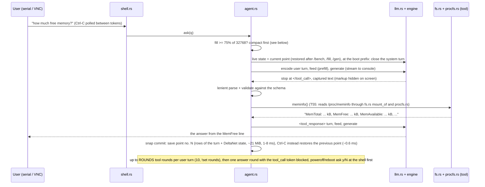
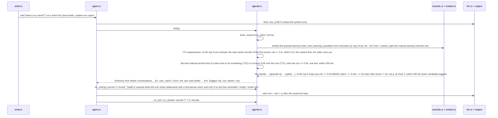
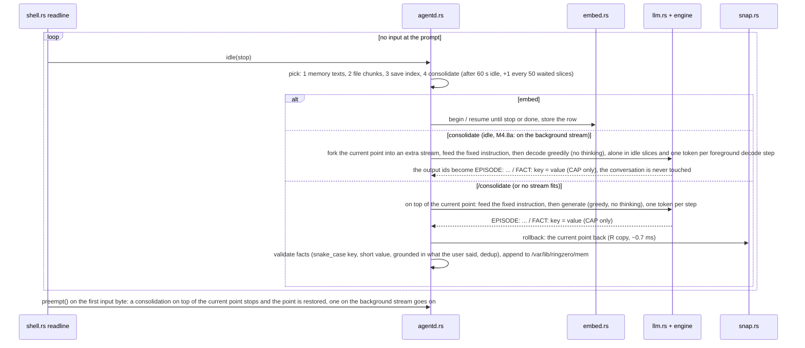
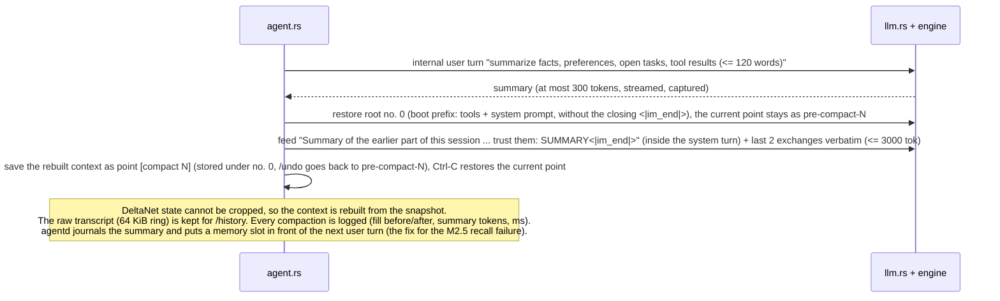

# ringzero architecture (as of M4.7 constrained tool calls + hibernation, with M5 MicroPython, M5b WASI and M7 Q4 + Qwen3.5-4B, editions ringzero Qwen35@2b-Qwen3@0.6b (default), Qwen35@4b.q4-Qwen3@0.6b, ...)

All diagrams of this page as one PDF: [ARCHITECTURE_DIAGRAMS.pdf](ARCHITECTURE_DIAGRAMS.pdf) (regenerate with `tools/arch_pdf.sh`, which also fails on any diagram that does not parse).

## Design principle: Unix-like

ringzero presents itself as a Unix: the models already know Linux, so the OS follows Linux/Unix conventions
wherever they fit (everything is a file: /proc, /sys as sysfs, /dev, /etc; familiar paths, command names and
outputs). New features expose state as files first and add a special tool only when a file cannot do the job.
ringzero's own data lives outside the Linux paths (/var/lib/ringzero, T55). Exact Linux formats are not required: familiar paths and names matter, content only needs to be clear, because the model interprets the output.

T54 put `/proc` in front of the volume; T55 made it a mount table: fs.rs `mount_of` routes `/proc` (procfs.rs),
`/sys` (sysfs.rs), `/dev` (devfs.rs) and the virtual `/etc/os-release` and `/etc/passwd` (layout.rs), everything
else is the FAT volume, so the shell's `!ls`/`!cat`, the agent's `ls`/`cat` tools and the WASI runtime see the same
tree through one path layer. A WASI open of a virtual file generates the content once and keeps the bytes in the
fd (no fatfs handle); /dev opens become `Fd::Dev` (null, zero, random, the raw disk) or `Fd::Tty`; every write path
is EROFS but `/sys/power/state` (`disk` hibernates) and the data devices. layout.rs runs right after the mount:
it moves a 0.1 disk's FAT `/sys` data to `/var/lib/ringzero` (copy, verify, commit marker, remove; no rename),
makes `/etc/hostname` and `/tmp`, and empties `/tmp` at a boot that does not resume a hibernation image.

## Diagram

```mermaid
flowchart TB
    subgraph FW["Firmware + boot"]
        BIOS["SeaBIOS / OVMF"] --> LIM["Limine v11<br/>paging, HHDM, MP, framebuffer,<br/>kernel ELF + model.asmbin + embed.asmbin modules"]
    end
    LIM --> KMAIN

    subgraph K["Rust no_std kernel (ring 0, soft-float)"]
        KMAIN["main.rs kmain<br/>boot sequence"]
        IDT["idt.rs<br/>exceptions, wake IPI, idle timer"]
        MEM["mem.rs<br/>bump arena, lower-half identity map,<br/>uncached MMIO map, 192 MiB kernel heap (linked_list_allocator,<br/>low-heap flag for wasm runs, M8),<br/>wasm slot: one linear memory, realloc in place (M5b)"]
        BLK["blk.rs: virtio-blk (virtio-drivers)<br/>PCI config via 0xCF8, BARs identity-mapped UC,<br/>DMA bounce ring in the arena, polling,<br/>byte stream for fatfs, 1-sector cache, write-through,<br/>1 MiB read-ahead on sequential reads (M4.8c)"]
        FS["fs.rs: FAT32 at / (fatfs 0.4, alloc)<br/>path checks (absolute, no '..', 255 B), 64 KiB writes,<br/>ls cat write mkdir -p rm [-r] df sync (unmount + remount),<br/>append, truncate, streamed read/write, walk, mtime from the RTC"]
        PROC["procfs.rs: /proc (T54)<br/>read-only virtual files generated at read time:<br/>cpuinfo, meminfo, uptime, version, devices, kmsg, mounts,<br/>bus/pci/devices (PCI bus 0 via 0xCF8); writes -> EROFS"]
        SYSFS["sysfs.rs: /sys (T55)<br/>class/block/vda, bus/pci/devices/ADDR,<br/>devices/system/cpu, power/state (disk -> hibernate)"]
        DEVFS["devfs.rs: /dev (T55)<br/>null, zero, random, urandom, tty, console, vda"]
        LAY["layout.rs (T55)<br/>/var/lib/ringzero paths, migration of a 0.1 disk<br/>(copy, verify, marker, remove), /etc/hostname,<br/>virtual os-release + passwd, /tmp clean"]
        FIDX["fidx.rs: file indexer<br/>queue of text files, ~1000 B chunks '[/path] text',<br/>T72: .csv / .tsv one row per chunk, header in front,<br/>table of indexed files (size, mtime)"]
        AGD["agentd.rs: memory subsystem<br/>idle scheduler (1 memory texts, 2 file chunks, 3 save index, 4 consolidate),<br/>context compiler (memory slot <= 200 tok,<br/>recalled notes filtered: cos, length, 3 lines, T35;<br/>T22: a how-to message gets the best manual section, also mid-conversation),<br/>T72 ranked answer: supersession (newest of a near-same group),<br/>manual first by margin 0.06, floors on the raw cosine,<br/>dates through the queues, index v1 migration, index.tsv,<br/>facts (validate, ground, dedup),<br/>consolidation (2B, greedy, on top of the current point), decision log"]
        MAN["docs/MANUAL.md, compiled in (include_str!, T22)<br/>one '## ' section = one index entry '[manual: TITLE] ...',<br/>boot: changed sections re-embedded, unchanged kept;<br/>T38: + their Q8_0 rows (include_bytes!, build/manvec.bin from a headless<br/>pass-1 boot: /man dump), used at boot when the key matches;<br/>T72: + the 54 hub probe questions' rows"]
        RANK["memrank.rs: design A rules (T72)<br/>54 probe questions, hub = mean cos of the 10 nearest,<br/>owner: relation words + alias table,<br/>penalty = 0.5 hub + owner 0.03 / 0.06, frozen weights"]
        MST["mstore.rs: /var/lib/ringzero/mem stores<br/>append-only records (len + checksum),<br/>journal, facts, episodes; torn tail cut at boot"]
        SMP["smp.rs<br/>TSC, x2APIC, AP release, parking"]
        CON["console.rs<br/>COM1 + framebuffer glyphs,<br/>ANSI SGR colors on both"]
        KBD["kbd.rs<br/>PS/2 set 1, layouts us / it, AltGr, Ctrl"]
        LOG["log.rs<br/>ring of 256 lines, level + timestamp"]
        SYS["sys.rs<br/>meminfo, cpuinfo, cores, uptime, CMOS RTC,<br/>poweroff, reboot"]
        SH["shell.rs<br/>text -> agent, !machine, /session commands,<br/>Tab completion, suggestions, history, Ctrl-C"]
        AG["agent.rs<br/>system prompt + tool registry, parser, validator,<br/>tool loop, 8 KiB result cap"]
        CM["agent.rs: context manager<br/>fill tracking, compaction (summary + rebuild),<br/>last 2 exchanges, raw transcript ring"]
        LLM["llm.rs<br/>golden self-test, bench, /fill, /gen, /prefill, tokenizer split,<br/>feed / generate, live token array,<br/>forward: prompt in blocks of B (32),<br/>M4.8b: prompt-lookup drafts, one verify pass,<br/>DeltaNet state copy for rollback,<br/>M4.8a: pass_bg: the background row rides along"]
        MUL["multi.rs: multi-stream decode (M4.8a)<br/>3 extra streams (4096 positions, own KV + DeltaNet),<br/>memory lent by the snapshot pool while open,<br/>fork the agent's context, step(rows of any stream),<br/>background stream for consolidation, /multi"]
        SNAP["snap.rs: state snapshots<br/>point tree (delta nodes), 1 GiB pool of 1 MiB chunks,<br/>undo / redo / retry, branches, saves, /tree,<br/>thinning + replay (batched), eviction,<br/>boot snapshot cache (/var/lib/ringzero/bootsnap.bin, 35 MiB),<br/>hibernation image: tree + pool chunks, state hash"]
        GRAM["gram.rs: tool-call grammar (M4.7a)<br/>byte automaton from the tool schemas (names, keys,<br/>enums, integers, required, closing tags),<br/>vocab trie: ids sorted by bytes + prefix lengths (1.2 MiB),<br/>check the pick; on a reject logits -> -inf, pick again;<br/>T39: draft(): the text the grammar implies up to the<br/>model's next choice, tokenized, as the speculative draft;<br/>T28: at a decision token (tool name, optional parameter,<br/>enum, integer) the margin p1 - p2 of the softmax over the<br/>allowed tokens, read from the pick's logits row"]
        DOC["docstate.rs: document states (M4.8c)<br/>/read PATH: file as a user turn + fixed reply,<br/>state of its tokens (ids, KV rows, R) cached in<br/>/var/lib/ringzero/cache/docs, key = boot key +<br/>context ids + file ids; 512 MiB cap, LRU"]
        HIB["hib.rs: hibernation (M4.7b)<br/>/hibernate, !poweroff, disk to /sys/power/state<br/>-> /var/lib/ringzero/hib/image.bin<br/>(tree, chunks, transcript, settings),<br/>resume at boot when the key matches"]
        EMB["embed.rs: second model<br/>Qwen3-Embedding g_ctx saved + swapped per call (+ matmul fp16 mode),<br/>embed(text, is_query): Instruct prefix, + endoftext,<br/>last-token x * w_final, Matryoshka dim, L2"]
        IDX["memidx.rs: memory index<br/>4096 Q8_0 rows, search = one tp_matmul_q8_0,<br/>score = cos - penalty, BM25 + stopwords, gated RRF fusion,<br/>T72: a date per entry, hub scores from the probe rows,<br/>save / load with a header (/var/lib/ringzero/mem/index.bin, v2)"]
        ENG["engine.rs<br/>FFI, output capture"]
        Q4T["q4test.rs (M7)<br/>boot check: Q4_0 kernel vs Q8_0 kernel<br/>on the unpacked rows, bit-identical"]
    end

    subgraph A["NASM engine (ring 0, AVX2/FMA/F16C)"]
        TR["transformer.asm<br/>Qwen3.5-2B: 6 full-attn + 18 DeltaNet layers<br/>or Qwen3.5-4B: 8 + 24 (DeltaNet 16 K / 32 V heads)<br/>Qwen3-Embedding-0.6B: 28 full-attn layers<br/>(one g_ctx loaded at a time)<br/>.asmbin v3 / v4: desc_tag_q4 marks Q4_0 slots"]
        KV["KV cache (6 full-attn layers)<br/>FP16 via F16C, 32768 tokens, 384 MiB<br/>(RINGZERO_KV=f32: FP32, 768 MiB)"]
        EKV["embedder arena<br/>KV 28 layers x 1024 tokens FP16, 113 MiB"]
        MM["matmul.asm Q8_0 + Q4_0 (M7, W4A8)<br/>tagged weight pointer -> matmul_q4_0_range<br/>batch kernels (AVX2, AVX-VNNI): Q4 row<br/>unpacked once into q4_rowbuf[tid]"]
        PF["prefill.asm (M4.8)<br/>transformer_prefill: B prompt tokens<br/>per weight pass, bit-exact;<br/>compute_logits 2 (M4.8b): logits of every row,<br/>one batched LM-head matmul;<br/>pf_ms (M4.8a): per-row stream table,<br/>rows of different streams in one pass"]
        MA["math.asm"]
        TOK["tokenizer.asm BPE"]
        WK["smp.asm<br/>tp_* dispatch + worker loop on APs 1..7"]
        CPU["cpu.asm<br/>enable_avx_fpu, float shims"]
    end

    subgraph P["MicroPython 1.29 (C, ring 0, SSE2 doubles; M5)"]
        UPY["upy.rs: !py, run_code tool,<br/>time budget + Ctrl-C (upy_check), stdout capture"]
        GLUE["kernel/upy/glue.c<br/>fresh interpreter per run on a 1 MiB stack,<br/>VM hook -> KeyboardInterrupt / hard abort, cut traceback"]
        UVM["py/ core (ports/embed): compiler, bytecode VM,<br/>GC heap 8 MiB, mpz ints, math via libm_dbl;<br/>mini libc (libc.c + mem* from compiler_builtins)"]
    end

    subgraph WS["WASI runtime (Rust, ring 0; M5b)"]
        WRT["wasm.rs: !wasm / !run, run_wasm tool,<br/>fresh wasmi Engine + Store per run, fuel slices of 10 M,<br/>budget + Ctrl-C + low heap between slices, memory cap (StoreLimits),<br/>stdout/stderr -> console or 6 KiB / 1500-token capture (M8)"]
        WASI["wasm.rs: WASI preview1 host functions<br/>args, environ, clocks, random (RDRAND), poll_oneoff,<br/>fd_* + path_* over fs.rs, preopen / = fd 3,<br/>'..' above / refused, /var/lib/ringzero EACCES, virtual files EROFS,<br/>T55: /dev devices (Fd::Dev), /sys/power/state, others ENOSYS;<br/>M8: open files keep their fatfs handle,<br/>console tty: fd 0 typed lines, /dev/tty raw, isatty"]
        WMI["wasmi 2.0.3 (interpreter, no_std + alloc)<br/>validate, lazy translation, register bytecode"]
    end

    subgraph D["Devices (QEMU q35)"]
        COM1["COM1 16550<br/>TCP 4555 + log file"]
        PS2["8042 PS/2<br/>(VNC keys)"]
        GOP["framebuffer<br/>(VNC :1)"]
        LAPIC["x2APIC / TSC-deadline"]
        VBLK["virtio-blk-pci<br/>build/disk.img (512 MiB FAT32)"]
        RTC["CMOS RTC (0x70/0x71)"]
        ACPI["ICH9 PM (S5), 8042 reset"]
    end

    KMAIN --> IDT & MEM & SMP & CON & FS & LLM & EMB & AGD & AG & SH
    SH -- "!ls !cat !write !mkdir !rm !df !sync" --> FS
    AG -- "ls, cat, write_file, mkdir, rm (y/N) tools" --> FS
    SH -- "!write, !rm" --> FIDX
    AG -- "write_file, rm" --> FIDX
    SH -- "idle at the prompt: one slice;<br/>any input: preempt" --> AGD
    SH -- "/agentd /facts /remember /forget<br/>/consolidate, !set consolidate|slot" --> AGD
    AG -- "memory slot for the first message,<br/>manual line for a how-to message,<br/>journal of turns + tool results,<br/>remember / forget (y/N) / recall tools" --> AGD
    CM -- "compaction done: slot on the next turn" --> AGD
    SH -- "/man [TOPIC]" --> AGD
    MAN -- "sections, queued when not in the index" --> AGD
    AGD -- "next_chunk / advance, boot scan<br/>(size + mtime vs the table)" --> FIDX
    AGD -- "embed::begin / resume (stop between forward calls)" --> EMB
    AGD -- "store rows, retain, search,<br/>save / load index.bin" --> IDX
    AGD -- "penalties(q)" --> RANK
    RANK -- "texts, hub scores" --> IDX
    AGD -- "append, load (recover torn tail)" --> MST
    MST --> FS
    AGD -- "/consolidate: fwd_block (one prefill block)<br/>or fwd + pick_next per step, output to CAP only" --> LLM
    AGD -- "/consolidate: rollback to the current point after<br/>it or on input" --> SNAP
    AGD -- "idle consolidation (M4.8a): bg_start (fork),<br/>bg_run in idle slices, output ids" --> MUL
    LLM -- "generate: the background row next to<br/>the foreground rows (pass_bg)" --> MUL
    MUL -- "transformer_prefill with pf_ms rows" --> PF
    MUL -- "lend / take_back: a slot's memory<br/>from free pool chunks" --> SNAP
    AG -- "boot: load_prefix or prefill + save_prefix<br/>(key: model, prefix ids, engine build)" --> SNAP
    SNAP -- "bootsnap.bin, hib/image.bin" --> FS
    LLM -- "after <tool_call>: fix(pick) per token,<br/>draft() before each verify (T39)" --> GRAM
    AG -. "tool schemas (SPECS)" .-> GRAM
    GRAM -- "-inf on rejected logits, vocab bytes" --> TR
    SH -- "!set constrain on|off,<br/>!set confidence on|off" --> GRAM
    GRAM -- "last_conf(): min margin of the call (T28)<br/>-> [confidence] line, band: run / log / y/N first" --> AG
    SH -- "/read PATH | clear" --> DOC
    DOC -- "hit: load rows + R (state_parts), commit;<br/>miss: feed, then save" --> SNAP
    DOC -- "miss: encode, feed (prefill)" --> LLM
    DOC -- "cache/docs/KEY.bin, free space" --> FS
    SH -- "/hibernate [discard|status]" --> HIB
    SYS -- "poweroff: hibernate first" --> HIB
    KMAIN -- "boot: trie, resume" --> GRAM & HIB
    HIB -- "hib_save / hib_load, state_hash" --> SNAP
    HIB -- "transcript, temperature, think, compaction" --> AG
    FIDX -- "read chunk, meta" --> FS
    FIDX -- "retain (drop old chunks)" --> IDX
    FS -- "file times" --> SYS
    SYS --> RTC
    SYS -- "shutdown: save the index" --> AGD
    FS --> BLK --> VBLK
    FS -- "mount_of: /proc" --> PROC
    FS -- "mount_of: /sys" --> SYSFS
    FS -- "mount_of: /dev" --> DEVFS
    FS -- "after the mount: migrate, /etc, /tmp;<br/>/etc/os-release, /etc/passwd" --> LAY
    SYSFS -- "PCI scan, roles" --> PROC
    SYSFS -- "power/state: disk" --> HIB
    WASI -- "Fd::Dev vda: read_raw" --> BLK
    PROC -- "cpu, memory, uptime" --> SYS
    PROC -- "drivers, PCI config" --> BLK
    BLK -- "DMA pages, bounce ring, map_mmio" --> MEM
    SYS -- "sync before poweroff / reboot" --> FS
    SH -- "!cmd" --> SYS
    SH -- "/embed /index" --> IDX
    SH -- "/search (ranked answer)" --> AGD
    IDX -- "embed doc / query" --> EMB
    IDX -- "tp_matmul_q8_0 over the rows" --> WK
    EMB -- "load embedder g_ctx, forward per token,<br/>2B g_ctx back before return" --> TR
    EMB -- "encode_plain (embedder BPE)" --> TOK
    TR -- "embedder forward" --> EKV
    SH -- "plain text" --> AG
    SH -- "/ctx /compact /history" --> CM
    SH -- "/undo /redo /tree /branch /switch<br/>/save /load /drop /snap, prompt" --> SNAP
    AG -- "commit after each turn,<br/>rollback on Ctrl-C" --> SNAP
    AG -- "fill >= 75%" --> CM
    CM -- "summary turn, restore root #0,<br/>re-prefill" --> LLM
    CM -- "pre-compact point,<br/>[compact N] point" --> SNAP
    SNAP -- "memcpy KV rows + DeltaNet state,<br/>replay of token ids" --> KV
    SNAP -- "pool" --> MEM
    AG -- "tool calls" --> SYS
    AG -- "read_log" --> LOG
    AG -- "set_setting" --> SH
    AG -- "y/N confirm" --> SH
    AG --> LLM --> ENG --> TR
    ENG -- "prompt blocks" --> PF
    LLM -- "verify: pending tokens + draft" --> PF
    SH -- "!set spec on|off|N" --> LLM
    PF -- "tp_matmul_q8_0_batch" --> WK
    PF -- "per token: rope_heads, tp_gqa_attn,<br/>tp_deltanet, g_dn_job" --> TR
    PF -- "vcvtps2ph K/V rows" --> KV
    TR --> MM & MA & WK
    KMAIN -- "after model_init (v4 models)" --> Q4T
    Q4T -- "tp_matmul_q8_0 (W | 1) and (unpacked W)" --> WK
    TR -- "vcvtps2ph / vcvtph2ps" --> KV
    LLM --> TOK
    TOK -- "sys_write_all" --> ENG --> CON
    TR -- "sys_mmap_anon" --> MEM
    SH --> KBD --> PS2
    SH --> CON --> COM1 & GOP
    SMP --> LAPIC
    SYS --> ACPI
    LOG -.->|klog! prints| CON
    KMAIN -- "upy::init: heap + stack" --> UPY
    UPY -- "sys_mmap_anon (before the snapshot pool)" --> MEM
    SH -- "!py CODE, !py -f PATH" --> UPY
    AG -- "run_code tool (5 s budget, 6 KiB output)" --> UPY
    UPY -- "-f: read script" --> FS
    UPY -- "upy_exec" --> GLUE --> UVM
    UVM -- "every 256 jumps: upy_poll -> upy_check" --> UPY
    UPY -- "Ctrl-C poll every 10 ms" --> SH
    UVM -- "print -> upy_out" --> UPY
    UPY --> CON
    KMAIN -- "wasm::init: slot (memory cap)" --> WRT
    WRT -- "sys_mmap_anon, set_wasm_slot" --> MEM
    SH -- "!wasm PATH|NAME ARGS [< FILE], !run" --> WRT
    AG -- "run_wasm tool (10 s budget, 6 KiB output)" --> WRT
    WRT -- "read .wasm, Module::new, instantiate,<br/>call_resumable / resume on OutOfFuel" --> WMI
    WMI -- "imports" --> WASI
    WASI -- "entry, list, open + read_at / write_file_at / set_len,<br/>touch, truncate, mkdir, rm, rename" --> FS
    WASI -- "typed input (shell::getb): REPLs, editor" --> SH
    WASI -- "fd_write 1/2" --> WRT
    WRT -- "Ctrl-C poll every 10 ms" --> SH
    WRT -- "upy::on_stack (shared 1 MiB stack)" --> UPY
    WRT --> CON
    WRT -- "encode_plain: output cut to 1500 tokens" --> LLM
```



Data flow of `how much free memory?` (plain text goes to the agent):



Memory slot at the start of a conversation (agentd context compiler; also on the first turn after a compaction):



Idle work (agentd scheduler, one slice per call from the line editor, at most 100 ms, stopped between engine steps by any input):



Compaction (auto at 75% fill, or `/compact`):



Legend:

- **Boot**: Limine loads the kernel, the 1.9 GiB model and the 613 MiB embedder as modules. `kmain` brings up
  the IDT, memory, SMP (APs enter the asm worker loop), checks the engine ABI, `model_init`s the 2B, then the
  embedder into its own context (embed.rs) and embeds one string through the swap, runs the 2B's golden
  self-test (after that swap round trip) and the bench, then `agent::init` prefills the system prompt + tool
  list once (832 tokens, about 17 s) and snapshots the engine state. Then `shell::run`.
- **Embedder** (embed.rs): Qwen3-Embedding-0.6B (Qwen3 dense, 28 layers, dim 1024) exported as .asmbin v3 runs
  on the same asm engine. All engine model state is `g_ctx` (640 B) plus matmul.asm's scale mode, so the
  embedder is a second saved `g_ctx` with its own arena (1024-token KV, 113 MiB). `with_embedder` swaps it in for
  one whole `embed()` call and restores the 2B's before returning: outside it the 2B context is always loaded,
  so snapshots, `llm::REC` and the agent never see the embedder, and its position-0 forward clears no 2B state.
  `embed(text, is_query)`: queries get `Instruct: {task}\nQuery:` (English task line), every input gets
  `<|endoftext|>` (151643), the vector is the last token's `x * w_final` (the RMSNorm scale cancels in the L2
  normalization, so the forward skips the lm_head), cut to the Matryoshka dim and L2-normalized.
- **agentd** (agentd.rs, mstore.rs, M4.5): the OS does the memory bookkeeping, the 2B only reads and writes it
  through typed tools (`remember`, `forget` with y/N, `recall`). Stores in `/var/lib/ringzero/mem` (T55; `/sys/mem`
  before, migrated by layout.rs) are append-only files of
  records `'R' kind len:u32 ts:u64 sum:u32 payload` (ts from the CMOS RTC, sum = folded FNV-1a): `journal.log`
  (U user turn, A answer, T tool result, C compaction summary, B boot, P poweroff), `facts.log` (S set
  `key\tvalue\tsource`, X forget; replayed, last wins), `episodes.log` (E). At boot each store is scanned to its
  last good record and a torn tail is truncated. Facts the model proposes (tool or consolidation) are checked by
  the kernel: snake_case key, value <= 120 B without markup, not a placeholder, key not equal to the value,
  grounded (every number and at least half of the words of 3+ characters appear in what the user said since the
  last consolidation), dedup by key. The context compiler builds a slot of at most 200 tokens (facts newest first
  within 120, then recalled notes) in front of the first message of a conversation and of the first turn after a
  compaction. T22: the manual (docs/MANUAL.md, compiled into the kernel) is indexed one section per entry as
  `[manual: TITLE] ...`; at boot and on a rebuild, indexed sections that are not in the kernel's manual any more
  are dropped and missing ones are queued, so only a changed section is embedded again. T38: with
  `MANUAL_VECTORS=1` the kernel also carries the sections' Q8_0 rows (computed by a pass-1 build of the same
  kernel booted headless, `/man dump`); when their key (section texts, embedder hash, engine hash, chunker version,
  dim) matches, missing sections are stored with those rows at boot and nothing is queued. Manual sections are
  ranked apart from the user's own memory (they never take one of its slot lines or recall hits); a message that
  asks how to do something gets the best section (cos >= 0.55) as one slot line, mid-conversation too, and
  `recall` adds it after its top 3 for a how-to message. Consolidation (after 60 s idle or `/consolidate`) runs the 2B greedy and without thinking on top of
  the current snapshot point, captures `EPISODE:` / `FACT:` lines, then restores the point. Every decision goes to
  the kernel log (level D) and the `/agentd log` ring (128 lines).
- **Boot snapshot cache** (snap.rs `save_prefix` / `load_prefix`, agent.rs): `/var/lib/ringzero/bootsnap.bin` holds the
  prefix state right after its prefill: a 48-byte header (key, pos, row bytes, planes, R bytes, FNV of the rest),
  the token ids, rows 0..pos of the 24 K/V planes and R (33 MiB for 1252 tokens). The key is FNV over the prefix
  ids, a sample hash of the model file, an engine build hash from build.rs (asm sources + KV flag), the KV element
  size and the context length. A hit loads it in 0.16-0.24 s; a miss prefills (5.8 s batched since M4.8, 26-40 s per token before) and
  writes it (2 s). The engine hash covers prefill.asm, so the M4.8 build misses once and rewrites the cache.
- **Document states** (docstate.rs, M4.8c): `/read PATH` encodes a text file (64 KiB at most, without special
  tokens) between a fixed user-turn head and a fixed assistant reply, closing the system turn first in a fresh
  conversation, and commits it as a snapshot point. For 512 tokens or more the state of those tokens goes to
  `/var/lib/ringzero/cache/docs/<fnv>.bin`: a 336-byte header (magic RZDS, version, boot key, context key, document
  key, base position, token count, row bytes, planes, R bytes, FNV of the rest, the path), the token ids, rows
  [base, base + n) of every K/V plane (`snap::state_parts`) and R. Context key = FNV over the token ids from the
  boot prefix to the file, so an entry is valid only at the same position after the same context; then loading
  the rows and R gives the prefill's state bit for bit. The load checks magic, keys, geometry and size before it
  reads, the token ids after the first part and a word-wise FNV after R; a failure deletes the entry, restores the
  current point if R was overwritten, and prefills. Writing a new entry deletes the older one of the same path
  and context (the file changed) and evicts other-model entries, then the least recently used (a hit rewrites the
  magic, refreshing the mtime), to stay within 512 MiB and keep 64 MiB free.
  blk.rs reads ahead for it: fatfs reads a file one cluster per request (4 KiB here); a direct read that continues
  the previous one fills a 1 MiB buffer in 64 KiB requests and the next reads copy from it, any write over those
  sectors drops it (the 4B entry, 185 MiB: 1.4-1.7 s before, 0.56-0.76 s after; the boot cache hit halves too).
- **Memory index** (memidx.rs): up to 4096 texts (2 KiB each, 1 MiB in all) with their embeddings as
  Q8_0 rows (int8 + fp16 block scales, the engine's weight layout; dim 1024 by default, `/index dim N` on an empty
  index). A search embeds the query and scores every row with one `tp_matmul_q8_0` on all cores, ranks by
  cosine minus the caller's penalty (T72: memrank.rs, half the hub score plus the owner penalties; the raw cosine
  is kept for the floors), and runs BM25 (k1 1.5, b 0.75, IT/EN stopwords) over the texts. BM25 joins the ranking (RRF, k 60) only
  when the query looks like an identifier or path (`a/b.c`, `HL-L2350DW`, `casa-wifi`, letters+digits, all caps)
  or when its top hit has every query term and at least 1.5x the second score. Used by `/index`, `/search` and the
  agent's `recall` tool (via agentd). Persistence: `/var/lib/ringzero/mem/index.bin` = a 72-byte header (embedder sample hash,
  dim, row stride, layout id, fidx chunker version, counts, FNV of the payload), agentd's extra lines (store sizes
  the index covers, the table of indexed files with size and mtime), then offsets, rows, texts and (version 2,
  T72) each entry's date; a version 1 file loads and its entries are dated by file mtime or boot date. Loaded at boot
  in about a millisecond; any header mismatch or a bad checksum means a rebuild in idle time. Records past the
  covered store sizes, and files whose size or mtime changed on the disk, are embedded again; nothing else.
  Entries: `[/path] chunk`, `[fact] key: value`, `[episode N] text`, `[said] user statement` (T35: only a statement
  with a first-person word, and not for a turn that acted with a tool; the journal replay applies the same rule).
- **Shell**: plain text goes to the agent; `!cmd` runs a machine command (mem, cpu, cores, log, uptime,
  kbd, set, park, stats, poweroff, reboot), `/cmd` a session command (help, clear, ctx, compact, history,
  think, temp, undo, redo, retry, tree, branch, switch, save, load, drop, snap, embed, index, search, bench, fill, gen; help and
  stats answer to both). Tab completes command names and first
  arguments, a bare `/` or `!` (pause or Enter) lists the commands, up/down recall the last 16 lines. Input from COM1 and PS/2 is polled into
  a type-ahead ring; 0x03 / Ctrl+C sets a flag that `llm::feed` and `llm::generate` check between tokens.
- **Agent**: Qwen3.5 native tool format (JSON tool lines in the system turn, `<tool_call><function=..>`
  calls, `<tool_response>` results in a user turn). The tokenizer splits special tokens and applies the
  Qwen pre-tokenizer regex before the engine BPE, so the prefix ids equal the HF tokenizer's
  (`tools/hf_prefix.py`, FNV hash printed at boot).
- **Snapshots** (snap.rs, design in [design/SNAPSHOTS.md](design/SNAPSHOTS.md)): the boot prefix is point
  #0, and every finished turn is saved as a child point: the KV rows the turn added (all 24 planes of the
  6 full-attention layers, head-major, FP16 or FP32 as `kv_elt_bytes` says, stored compactly, 85 rows per
  1 MiB chunk with FP16) plus their token ids, and the whole DeltaNet recurrent + conv state R (19.3 MiB,
  it cannot be diffed). The live rows `0..pos` always belong to the chain of one point, so `/undo` along
  the chain copies R only (~0.6 ms) and `/switch` copies the rows above the common ancestor. Names:
  branches (the prompt shows the current one, `main~N` after an undo), saves, and kernel names
  (`main@N` for a line left by typing after an undo, `pre-compact-N`). Pool: 1 GiB of 1 MiB chunks with a
  bitmap, touched at boot. Before a save the pool keeps 64 MiB free: first it thins unnamed points off the
  current line and outside its last 16 (R freed, rows kept; restoring one replays its token ids from the
  nearest stored R in prefill blocks and checks the R hash), then drops kernel-named lines unvisited for 32 turns, never
  user names. Ctrl-C, an interrupted compaction and `/bench` `/fill` `/gen` (which run from position 0)
  restore the current point. Copies run on the BSP between turns, never inside `transformer_forward`, and
  never at position 0 (the engine zeroes R there).
- **KV cache**: 32768 tokens. FP16 (default build) stores K/V rows with `vcvtps2ph` and reads them with
  `vcvtph2ps` inside `gqa_attn_range` (12 KiB/token, 384 MiB); `RINGZERO_KV=f32 make iso` builds the FP32
  cache (24 KiB/token, 768 MiB). `model_init` takes the 32768 override although the .asmbin header says 4096.
- **Context manager**: fill is tracked in tokens (`/ctx`, stats line). Past `compact` percent (75 by
  default, `!set compact N`) the next turn first compacts (diagram above), if more than 2 exchanges came
  after the last compaction (no compaction loop at low thresholds). The boot snapshot stops 2 tokens short
  of the system turn's `<|im_end|>\n`, so the summary lands in the system prompt (the model distrusted it
  as a user turn); a fresh conversation feeds those 2 tokens. Tool results are capped at
  8 KiB with a visible truncation marker.
- **Log**: `klog!` prints and records `[sec.ms] L text` (I info, W warn, E error, A agent) in a 256-line
  ring, read by `log` and by the `read_log` tool.
- **Keyboard**: scancode set 1, layouts as data (`us`, `it` default), Shift, Ctrl, AltGr (E0 38, and left
  Alt for macOS VNC clients). `kbd` builtin or `set_setting keyboard`.

## Boot flow

1. Firmware (SeaBIOS or UEFI/OVMF) starts Limine from the ISO (El Torito: `limine-bios-cd.bin`
   for BIOS, `limine-uefi-cd.bin` / `BOOTX64.EFI` for UEFI).
2. Limine reads `limine.conf`, loads `/boot/kernel` (ELF, linked at `0xffffffff80000000`),
   `/boot/model.asmbin` and `/boot/embed.asmbin` as modules (found by path), sets a GOP/VBE framebuffer, builds 4-level paging with the
   HHDM (base revision 3), starts every AP and parks it, then jumps to `kmain` on the BSP in
   long mode with a Limine stack. The IDT is undefined at this point.
3. `kmain` (kernel/src/main.rs): console on COM1 + framebuffer, boot banner, IDT, CPUID check, `enable_avx_fpu`,
   TSC calibration (PIT ch2), memory map log, arena + model + embedder identity maps, AP release, `model_init`
   (2B), `embed::init` (embedder context) + boot embedding, `agentd::init` (stores recovered, index loaded or
   rebuilt, files compared with the index table), golden self-test, bench, agent prefix from the boot snapshot
   cache or a prefill (kernel/src/agent.rs), snapshot #0, the vocab trie of the tool-call grammar
   (kernel/src/gram.rs), the hibernation image resumed when its key matches (kernel/src/hib.rs), then the shell
   (kernel/src/shell.rs).

## Prefill path (M4.8)

`llm::forward(tokens, pos0, logits)` is the one entry for prompt tokens: `run` (self-test, bench, `/gen`),
`/fill`, `feed` (boot prefix on a cache miss, agent turns with the memory slot, tool results, the compaction
summary turn and its re-prefill), agentd consolidation (`fwd_block`: one block per idle step, so a keystroke
still stops it between engine calls) and the snapshot replay of a thinned point (also after a hibernation
resume). Only decode, the 2 tokens that close the system turn, and the embedder (own `g_ctx`) stay per token. It cuts the prompt into blocks of `B` tokens (default 32, `/prefill B`; 1 =
the old per-token path) and calls `transformer_prefill(toks, n, pos0, logits)` (engine/prefill.asm) per
block; decode stays `transformer_forward`, one token per call, unchanged.

Per layer and block, the matmuls take all n activation rows at once and the rest runs per token:

```
rmsnorm x_b -> xb_b                       (per token)
tp_matmul_q8_0_batch(W_proj)              quantize n rows (quantize_x_q8_0_to, same bytes as decode),
                                          one SMP job over the weight rows: each row read once, n dots
full attn:  per token, in prompt order: QK-norm, RoPE(pos), K/V store at pos, tp_gqa_attn over 0..pos,
            output gate -> causal inside the block and over the cached past
DeltaNet:   per token, in prompt order: a/b dots, conv4_step, SiLU, tp_deltanet (recurrence), silu(z)
tp_matmul_q8_0_batch(W_out), residual, post-norm, tp_matmul_q8_0_batch(W_gateup), SwiGLU,
tp_matmul_q8_0_batch(W_down), residual
```

The per-token parts reuse the vendored kernels by pointing `g_ctx` BUF_Q / BUF_ATT_OUT at the token's
row (restored on return). Buffers: `prefill_init(64)` takes 7 MiB from the arena at model init, before
the snapshot pool. Batch matmul kernels (engine/matmul.asm, job kind `tp_K = 2` in smp.asm):
`matmul_q8_0_batch_range` (AVX2, the decode kernel's sequence per row and token) and
`matmul_q8_0_batch_vnni` (AVX-VNNI `vpdpbusd` on x + 128 with a -128 * sum(w) row correction: the same
int32 per lane, so the same floats), picked by CPUID at `prefill_init`. Both leave the model state
bit-identical to the per-token path (docs/BATCHED_PREFILL_RESULT.md).

## Speculative decoding (M4.8b)

`llm::generate` streams the answer of an agent turn. With `!set spec on` (default) each step looks up the end
of the context (REC after the boot prefix + the emitted tokens not fed yet) in the earlier context; the longest
earlier match (3 to 32 tokens) gives a draft of up to `match - 1` tokens (8 at most by default). The pending
tokens and the draft go through one `transformer_prefill(.., compute_logits = 2)`: logits for every row
from `pf_lg0` on, the LM head as one batched matmul into 16 rows from the arena. Each row is copied to
BUF_LOGITS and picked as the per-token loop would (sampler, `gram::fix` inside a tool call, stop checks); the
draft is accepted while it matches.

```
emit(next) -> lookup -> no draft: transformer_forward(next)            (as before)
                     -> draft d1..dk: copy DeltaNet state (50.3 MiB, 4B)
                                      transformer_prefill([pending.., next, d1..dk], logits per row)
                                      row i: pick -> == d(i+1)? emit, next row : stop
                                      all accepted: keep state | else: copy DeltaNet state back,
                                      accepted tokens become pending (fed in front of the next pass)
```

KV rows of rejected positions are left in the cache and overwritten later (attention reads 0..pos). Every
row's logits are bit-identical to `transformer_forward` (`/spec [N]` checks it), so the emitted ids are the same
as with `!set spec off`, greedy or sampled. Results: docs/M48B_RESULT.md.

T39: inside a tool call the draft comes first from the grammar (`gram::draft`, `!set gramdraft on|off`, default
on): from the automaton's state it writes the text the call format implies up to the model's next choice (the rest
of a tool or parameter name once one is left that fits the prefix, `>`, `\n`, `<parameter=` while a required
parameter is missing, `</parameter>`, `</function>`, a unique enum value), tokenizes it with the model's BPE and
hands it to the same verify pass; only when it is empty does the prompt lookup run. `</tool_call>` is not drafted:
it comes as the pick after a fully accepted draft. Grammar drafts do not move the lookup's length and back-off
gate. Results: docs/T39_RESULT.md.

T28: every pick inside a call goes through `gram::fix`, in a decode step or a verify row; when its bytes make a
decision (tool name, a parameter with an optional one among the candidates, optional parameter or end, enum value,
integer), `margin` walks the vocab trie from the state before the pick and takes P(best) - P(second) of the softmax
over the allowed tokens, grouped by outcome. The logits are only read. agent.rs prints the call's smallest margin as
a `[confidence]` line and picks the band (`CONF_LO` = `make CONF_ASK`, default 0.80; `CONF_HI` = max(0.80, `CONF_LO`)): run, run and log, or y/N first for the tools
that write (write_file, mkdir, set_setting, remember; T54). Results: docs/T28_RESULT.md.

## Multi-stream decode (M4.8a)

One decode step reads every weight once for one token. `transformer_prefill` takes an optional row table
(`pf_ms`, 6 x u64 per row: position, K cache, V cache, DeltaNet state, conv history, max_seq): before a row's
attention or DeltaNet step the five g_ctx stream fields are pointed at that row's stream and restored on return,
so rows of different conversations share each batched matmul (the weights are read once for all of them) while
attention, the DeltaNet recurrence and the conv history run per row on their own stream. Rows of one stream behave
exactly as the batched prefill. The matmuls repeat the per-token arithmetic, so every stream's logits are
bit-identical to decoding it alone (`/multi [N] [T]` checks the ids and every step's logits).

```
streams: 0 = the agent's context (g_ctx buffers, 32768 positions, snapshots, hibernation)
         1..3 = multi.rs slots (4096 positions, own KV + DeltaNet state, memory lent by the snapshot pool
                while open: snap::lend / take_back, a contiguous run of free chunks; never saved)
generate step with a background row:  rows [fg pending.., fg next, (draft..)] + [bg token]  -> one pass
                                      fg logits rows -> pick as before;  bg row -> argmax -> next bg token
```

The one user is agentd's idle consolidation: `bg_start` forks the agent's context at the current point into slot 1
(KV rows 0..pos per plane and the DeltaNet state copied), queues the fixed instruction and decodes greedily.
`bg_run` advances it alone in idle slices (instruction in blocks of 32 rows, then one row per pass), and
`llm::pass_bg` appends its row to every foreground decode pass (a plain step or a speculative verify), so input at
the prompt does not stop it. The output ids go through the same capture as before and give the same text.
`/consolidate &` starts the same at once and returns to the prompt. `/consolidate`, and a conversation longer
than the slot, keep the M4.5 path on top of the current point.
Results: docs/M48A_RESULT.md.

## Memory

- Kernel image: higher half, 3 PT_LOAD segments (RX text, R rodata, RW data+bss). The engine's
  `.text/.rodata/.bss` (incl. `g_ctx`) are part of these segments. Engine objects are
  PC32-relative only, so they link at any address within +-2 GiB of their callers.
- Physical memory is reached through the HHDM (`phys + hhdm_offset`). In base revision 3 the
  HHDM covers usable, bootloader, kernel/module and framebuffer regions only; MMIO
  (LAPIC, IOAPIC, PCI BARs) must be mapped by us.
- The models are Limine modules: physically contiguous, already in RAM, mapped in the HHDM. The guest has
  6 GiB since the embedder (`GUEST_MEM`, docs/EMBEDDER_RESULT.md): on q35 the 2B lands below 4 GiB
  (`0x65b8000`, 1922 MiB), the embedder at the top of RAM (`0x1d9a9d000`, 613 MiB), and the usable run
  `0x100000000 + 3482 MiB` in between is the engine's arena (`sys_mmap_anon`): 2B 406 MiB, embedder 113 MiB,
  snapshot pool 1 GiB, about 2 GiB free. With 4 GiB the same layout leaves 1434 MiB and the pool drops to 512 MiB.
- The engine treats a negative `sys_mmap_anon` result as an error (transformer.asm:529), and HHDM
  addresses are negative. So the arena (largest usable region, bump allocator, kernel/src/mem.rs) and
  both models are **identity-mapped in the lower half with 2 MiB pages**, added to Limine's page tables
  before the APs start (they share CR3). `model_init` gets the model's physical (= identity) address.
- The memory index (rows 4.25 MiB, texts 1 MiB, BM25 scratch) is static data in the kernel image (`.bss`); its
  file is read straight into those arrays. agentd's facts, queue and session text live on the kernel heap.
- The tool-call grammar's vocab trie (M4.7a: 248044 token ids sorted by bytes + a prefix-length byte each,
  1.2 MiB) is `.bss` too; it points into the model's own token table (no copy of the bytes). The mask writes
  -inf straight into the engine's logits buffer before argmax / top-p.
- Hibernation (M4.7b) reads and writes pool chunks in place (1 MiB each, no staging copy); only the metadata
  (point and name tables, texts, a few KiB) and the transcript go through the kernel heap.
- MicroPython (M5) takes 8 MiB GC heap + 1 MiB stack from the arena right after the kernel heap, before the
  models and the snapshot pool (arena use 520 -> 529 MiB). Its C code (~286 KB of text) is linked into the
  kernel image with `-mcmodel=kernel -mno-red-zone`, uses SSE2 for doubles (the Rust side stays soft-float,
  no float crosses the FFI) and runs on the BSP between model calls, on its own stack.
- The WASI runtime (M5b) takes the wasm slot (256 MiB, `RINGZERO_WASM_MIB`) from the arena after MicroPython,
  and the kernel heap grew from 16 to 64 MiB for wasmi (module bytes, translated code, the store). The global
  allocator in mem.rs routes one allocation to the slot: the first one of whole 64 KiB pages while wasm.rs is
  instantiating, the linear memory's initial size. Its reallocs (wasmi grows memories by doubling a Vec) stay in
  place, so a 128 -> 256 MiB step needs no second buffer; StoreLimits keeps the memory within the cap. RAM free
  2003 -> 1694 MiB. wasmi (portable dispatch, simd) and wasm.rs add 1.87 MB of kernel text. A run is on the BSP,
  on MicroPython's 1 MiB stack (upy::on_stack), between model calls.
- M8: the kernel heap is 192 MiB (`RINGZERO_HEAP_MIB`): CPython's 31 MB module is read into it, and wasmi keeps
  its own copy and the translated code there (peak 93 MiB for a Python run). wasmi allocates with infallible
  `alloc`, so instead of a panic on OOM the allocator raises a flag below 12 MiB free and wasm.rs stops the run
  at its next fuel slice; dropping the store frees everything. RAM free 1694 -> 1566 MiB.
- No heap and no general frame allocator yet. The snapshot pool (1 GiB taken from the arena at boot, 1 MiB
  chunks, bitmap) is the only memory that is freed and reused.

## Where the engine sits

```
Rust kernel (ring 0, soft-float)          NASM engine (ring 0, AVX2/FMA/F16C)
  kmain ---- calls ---------------------->  silu_mul_avx2, argmax_f32 (M0 self-test)
                                             model_init, transformer_forward, tok_* (M1)
  embed.rs: model_init (2nd), g_ctx swap,
            matmul_set_fp16 --------------->  transformer_forward on the embedder context
  memidx.rs: tp_matmul_q8_0 ------------->  index rows x query (engine/smp.asm, all cores)
  llm.rs: prefill_init, transformer_prefill ->  prompt blocks (engine/prefill.asm, M4.8),
          transformer_prefill(.., 2)  ------->  speculative verify, logits per row (M4.8b)
  sys_mmap_anon / sys_munmap   <-- imports -- transformer.asm   (mem.rs)
  sys_write_all / str_len      <-- imports -- tokenizer.asm     (engine.rs)
  tp_matmul_q8_0 / tp_gqa_attn /
  tp_deltanet                  <-- imports -- transformer.asm   (engine/smp.asm)
```

## SMP

Limine MP (x2APIC requested) starts every AP. `smp::start` writes `tid` into each AP's
`extra_argument` and its `goto_address` = `ap_limine_entry` (engine/smp.asm): own 64 KiB stack,
`ap_init` (lidt, LAPIC enable), `enable_avx_fpu`, then the asm OS worker loop. The BSP is tid 0 and
runs its own slice inside `tp_*`, so `transformer_forward` is called from the BSP only.

Idle workers spin for `tp_park_tsc` cycles, then, if `tp_park_enable`, count themselves in
`tp_n_parked` and `hlt`. A dispatcher that sees `tp_n_parked != 0` sends one broadcast IPI (vector
0xF0, EOI-only handler). Default policy: parking disabled during a generation, enabled between
requests (parking inside a generation costs 27-46% decode, see M1_RESULT.md). The BSP waits for input
in `hlt` with a 1 kHz TSC-deadline timer (vector 0xF1).

Interrupts stay off (IF=0) everywhere except inside those `sti; hlt` windows, so the engine is never
interrupted and the soft-float Rust handlers never need to save vector state.

The Rust target is soft-float, so Rust never touches xmm/ymm and the engine owns the vector
state. Consequence: engine functions that take float args in xmm registers need a small asm shim
before Rust can call them. `enable_avx_fpu` must run on every core that executes engine code.

## Still asm vs Rust

| Part | Language |
|---|---|
| Inference engine (math, matmul, tokenizer, transformer), vendored; ringzero changes marked in transformer.asm: FP16 KV store/read, max_seq override, rope_heads / g_dn_job exported; in matmul.asm: quantize_x_q8_0_to, batch kernels | NASM |
| Batched prefill (engine/prefill.asm, M4.8) and the batch matmul job kind (engine/smp.asm) | NASM |
| `enable_avx_fpu` (engine/cpu.asm, from the old boot.asm) | NASM |
| Boot, paging, AP startup | Limine |
| `sample_top_p_bits` float shim (engine/cpu.asm) | NASM |
| SMP dispatch (`tp_*`), worker loop, AP entry, parking (engine/smp.asm, adapted from the asm OS) | NASM |
| Console, IDT, CPU checks, TSC calibration, memory maps, AP release, generation loop | Rust |
| Shell (! and / commands, completion, history), keyboard layouts, kernel log, agent (prompt, tools, parser, loop), context compaction, transcript, tokenizer pre-split, state snapshots (pool, point tree, undo, branches, boot cache), embedder context swap and pooling, memory index (Q8_0 rows, BM25, fusion, persistence), agentd (stores, scheduler, context compiler, consolidation, fact validation) | Rust |
