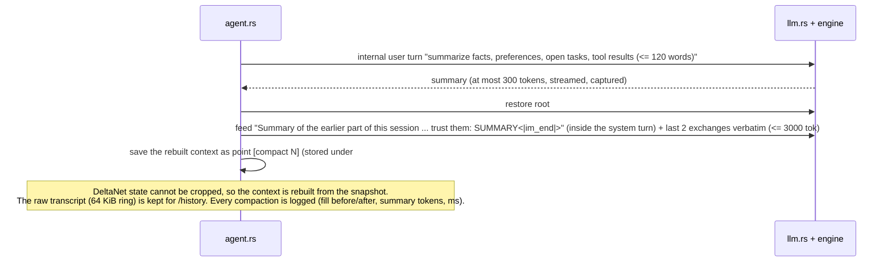

# ringzero architecture (as of the embedder milestone, edition ringzero Qwen35@2b-Qwen3@0.6b)

## Diagram

```mermaid
flowchart TB
    subgraph FW["Firmware + boot"]
        BIOS["SeaBIOS / OVMF"] --> LIM["Limine v11<br/>paging, HHDM, MP, framebuffer,<br/>kernel ELF + model.asmbin + embed.asmbin modules"]
    end
    LIM --> KMAIN

    subgraph K["Rust no_std kernel (ring 0, soft-float)"]
        KMAIN["main.rs kmain<br/>boot sequence"]
        IDT["idt.rs<br/>exceptions, wake IPI, idle timer"]
        MEM["mem.rs<br/>bump arena, lower-half identity map"]
        SMP["smp.rs<br/>TSC, x2APIC, AP release, parking"]
        CON["console.rs<br/>COM1 + framebuffer glyphs"]
        KBD["kbd.rs<br/>PS/2 set 1, layouts us / it, AltGr, Ctrl"]
        LOG["log.rs<br/>ring of 256 lines, level + timestamp"]
        SYS["sys.rs<br/>meminfo, cpuinfo, cores, uptime,<br/>poweroff, reboot"]
        SH["shell.rs<br/>text -> agent, !machine, /session commands,<br/>Tab completion, suggestions, history, Ctrl-C"]
        AG["agent.rs<br/>system prompt + tool registry, parser, validator,<br/>tool loop, 8 KiB result cap"]
        CM["agent.rs: context manager<br/>fill tracking, compaction (summary + rebuild),<br/>last 2 exchanges, raw transcript ring"]
        LLM["llm.rs<br/>golden self-test, bench, /fill, /gen, tokenizer split,<br/>feed / generate, live token array"]
        SNAP["snap.rs: state snapshots<br/>point tree (delta nodes), 1 GiB pool of 1 MiB chunks,<br/>undo / redo / retry, branches, saves, /tree,<br/>thinning + replay, eviction"]
        EMB["embed.rs: second model<br/>Qwen3-Embedding g_ctx saved + swapped per call (+ matmul fp16 mode),<br/>embed(text, is_query): Instruct prefix, + endoftext,<br/>last-token x * w_final, Matryoshka dim, L2"]
        IDX["memidx.rs: memory index (RAM)<br/>4096 Q8_0 rows, search = one tp_matmul_q8_0,<br/>BM25 + stopwords, gated RRF fusion"]
        ENG["engine.rs<br/>FFI, output capture"]
    end

    subgraph A["NASM engine (ring 0, AVX2/FMA/F16C)"]
        TR["transformer.asm<br/>Qwen3.5-2B: 6 full-attn + 18 DeltaNet layers<br/>Qwen3-Embedding-0.6B: 28 full-attn layers<br/>(one g_ctx loaded at a time)"]
        KV["KV cache (6 full-attn layers)<br/>FP16 via F16C, 32768 tokens, 384 MiB<br/>(RINGZERO_KV=f32: FP32, 768 MiB)"]
        EKV["embedder arena<br/>KV 28 layers x 1024 tokens FP16, 113 MiB"]
        MM["matmul.asm Q8_0"]
        MA["math.asm"]
        TOK["tokenizer.asm BPE"]
        WK["smp.asm<br/>tp_* dispatch + worker loop on APs 1..7"]
        CPU["cpu.asm<br/>enable_avx_fpu, float shims"]
    end

    subgraph D["Devices (QEMU q35)"]
        COM1["COM1 16550<br/>TCP 4555 + log file"]
        PS2["8042 PS/2<br/>(VNC keys)"]
        GOP["framebuffer<br/>(VNC :1)"]
        LAPIC["x2APIC / TSC-deadline"]
        ACPI["ICH9 PM (S5), 8042 reset"]
    end

    KMAIN --> IDT & MEM & SMP & CON & LLM & EMB & AG & SH
    SH -- "!cmd" --> SYS
    SH -- "/embed /index /search" --> IDX
    AG -- "search_memory tool<br/>(between 2B forward calls)" --> IDX
    IDX -- "embed doc / query" --> EMB
    IDX -- "tp_matmul_q8_0 over the rows" --> WK
    EMB -- "load embedder g_ctx, forward per token,<br/>2B g_ctx back before return" --> TR
    EMB -- "encode_plain (embedder BPE)" --> TOK
    TR -- "embedder forward" --> EKV
    SH -- "plain text" --> AG
    SH -- "/ctx /compact /history" --> CM
    SH -- "/undo /redo /tree /branch /switch<br/>/save /load /drop /snap, prompt" --> SNAP
    AG -- "commit after each turn,<br/>rollback on Ctrl-C" --> SNAP
    AG -- "fill >= 75%" --> CM
    CM -- "summary turn, restore root #0,<br/>re-prefill" --> LLM
    CM -- "pre-compact point,<br/>[compact N] point" --> SNAP
    SNAP -- "memcpy KV rows + DeltaNet state,<br/>replay of token ids" --> KV
    SNAP -- "pool" --> MEM
    AG -- "tool calls" --> SYS
    AG -- "read_log" --> LOG
    AG -- "set_setting" --> SH
    AG -- "y/N confirm" --> SH
    AG --> LLM --> ENG --> TR
    TR --> MM & MA & WK
    TR -- "vcvtps2ph / vcvtph2ps" --> KV
    LLM --> TOK
    TOK -- "sys_write_all" --> ENG --> CON
    TR -- "sys_mmap_anon" --> MEM
    SH --> KBD --> PS2
    SH --> CON --> COM1 & GOP
    SMP --> LAPIC
    SYS --> ACPI
    LOG -.->|klog! prints| CON
```



Data flow of `how much free memory?` (plain text goes to the agent):

```mermaid
sequenceDiagram
    participant U as User (serial / VNC)
    participant S as shell.rs
    participant A as agent.rs
    participant L as llm.rs + engine
    participant T as sys.rs (tool)
    U->>S: "how much free memory?" (Ctrl-C polled between tokens)
    S->>A: ask(q)
    A->>A: fill >= 75% of 32768? compact first (see below)
    A->>L: live state = current point (restored after /bench, /fill, /gen); at the boot prefix: close the system turn
    A->>L: encode user turn, feed (prefill), generate (stream to console)
    L-->>A: stop at </tool_call>, captured text (markup hidden on screen)
    A->>A: lenient parse + validate against the schema
    A->>T: meminfo()
    T-->>A: "RAM total 4095 MiB, free 2057 MiB, ..."
    A->>L: <tool_response> turn, feed, generate
    L-->>U: "La memoria libera è di 2057 MiB."
    A->>A: snap commit: save point #N (rows of the turn + DeltaNet state, ~21 MiB, 1-8 ms); Ctrl-C instead restores the previous point (~0.6 ms)
    Note over A: up to 4 tool rounds per user turn, poweroff/reboot ask y/N at the shell first
```

Compaction (auto at 75% fill, or `/compact`):



Legend:

- **Boot**: Limine loads the kernel, the 1.9 GiB model and the 613 MiB embedder as modules. `kmain` brings up
  the IDT, memory, SMP (APs enter the asm worker loop), checks the engine ABI, `model_init`s the 2B, then the
  embedder into its own context (embed.rs) and embeds one string through the swap, runs the 2B's golden
  self-test (after that swap round trip) and the bench, then `agent::init` prefills the system prompt + tool
  list once (832 tokens, about 17 s) and snapshots the engine state. Then `shell::run`.
- **Embedder** (embed.rs): Qwen3-Embedding-0.6B (Qwen3 dense, 28 layers, dim 1024) exported as .asmbin v3 runs
  on the same asm engine. All engine model state is `g_ctx` (640 B) plus matmul.asm's scale mode, so the
  embedder is a second saved `g_ctx` with its own arena (1024-token KV, 113 MiB). `with_embedder` swaps it in for
  one whole `embed()` call and restores the 2B's before returning: outside it the 2B context is always loaded,
  so snapshots, `llm::REC` and the agent never see the embedder, and its position-0 forward clears no 2B state.
  `embed(text, is_query)`: queries get `Instruct: {task}\nQuery:` (English task line), every input gets
  `<|endoftext|>` (151643), the vector is the last token's `x * w_final` (the RMSNorm scale cancels in the L2
  normalization, so the forward skips the lm_head), cut to the Matryoshka dim and L2-normalized.
- **Memory index** (memidx.rs, RAM only): up to 4096 texts (2 KiB each, 1 MiB in all) with their embeddings as
  Q8_0 rows (int8 + fp16 block scales, the engine's weight layout; dim 1024 by default, `/index dim N` on an empty
  index). A search embeds the query and scores every row with one `tp_matmul_q8_0` on all cores, ranks by
  cosine, and runs BM25 (k1 1.5, b 0.75, IT/EN stopwords) over the texts. BM25 joins the ranking (RRF, k 60) only
  when the query looks like an identifier or path (`a/b.c`, `HL-L2350DW`, `casa-wifi`, letters+digits, all caps)
  or when its top hit has every query term and at least 1.5x the second score. Used by `/index`, `/search` and the
  agent's `search_memory` tool; the API (add, search, text, len, clear, set_dim) is what agentd will reuse.
- **Shell**: plain text goes to the agent; `!cmd` runs a machine command (mem, cpu, cores, log, uptime,
  kbd, set, park, stats, poweroff, reboot), `/cmd` a session command (help, clear, ctx, compact, history,
  think, temp, undo, redo, retry, tree, branch, switch, save, load, drop, snap, embed, index, search, bench, fill, gen; help and
  stats answer to both). Tab completes command names and first
  arguments, a bare `/` or `!` (pause or Enter) lists the commands, up/down recall the last 16 lines. Input from COM1 and PS/2 is polled into
  a type-ahead ring; 0x03 / Ctrl+C sets a flag that `llm::feed` and `llm::generate` check between tokens.
- **Agent**: Qwen3.5 native tool format (JSON tool lines in the system turn, `<tool_call><function=..>`
  calls, `<tool_response>` results in a user turn). The tokenizer splits special tokens and applies the
  Qwen pre-tokenizer regex before the engine BPE, so the prefix ids equal the HF tokenizer's
  (`tools/hf_prefix.py`, FNV hash printed at boot).
- **Snapshots** (snap.rs, design in [design/SNAPSHOTS.md](design/SNAPSHOTS.md)): the boot prefix is point
  #0, and every finished turn is saved as a child point: the KV rows the turn added (all 24 planes of the
  6 full-attention layers, head-major, FP16 or FP32 as `kv_elt_bytes` says, stored compactly, 85 rows per
  1 MiB chunk with FP16) plus their token ids, and the whole DeltaNet recurrent + conv state R (19.3 MiB,
  it cannot be diffed). The live rows `0..pos` always belong to the chain of one point, so `/undo` along
  the chain copies R only (~0.6 ms) and `/switch` copies the rows above the common ancestor. Names:
  branches (the prompt shows the current one, `main~N` after an undo), saves, and kernel names
  (`main@N` for a line left by typing after an undo, `pre-compact-N`). Pool: 1 GiB of 1 MiB chunks with a
  bitmap, touched at boot. Before a save the pool keeps 64 MiB free: first it thins unnamed points off the
  current line and outside its last 16 (R freed, rows kept; restoring one replays its token ids from the
  nearest stored R and checks the R hash), then drops kernel-named lines unvisited for 32 turns, never
  user names. Ctrl-C, an interrupted compaction and `/bench` `/fill` `/gen` (which run from position 0)
  restore the current point. Copies run on the BSP between turns, never inside `transformer_forward`, and
  never at position 0 (the engine zeroes R there).
- **KV cache**: 32768 tokens. FP16 (default build) stores K/V rows with `vcvtps2ph` and reads them with
  `vcvtph2ps` inside `gqa_attn_range` (12 KiB/token, 384 MiB); `RINGZERO_KV=f32 make iso` builds the FP32
  cache (24 KiB/token, 768 MiB). `model_init` takes the 32768 override although the .asmbin header says 4096.
- **Context manager**: fill is tracked in tokens (`/ctx`, stats line). Past `compact` percent (75 by
  default, `!set compact N`) the next turn first compacts (diagram above), if more than 2 exchanges came
  after the last compaction (no compaction loop at low thresholds). The boot snapshot stops 2 tokens short
  of the system turn's `<|im_end|>\n`, so the summary lands in the system prompt (the model distrusted it
  as a user turn); a fresh conversation feeds those 2 tokens. Tool results are capped at
  8 KiB with a visible truncation marker.
- **Log**: `klog!` prints and records `[sec.ms] L text` (I info, W warn, E error, A agent) in a 256-line
  ring, read by `log` and by the `read_log` tool.
- **Keyboard**: scancode set 1, layouts as data (`us`, `it` default), Shift, Ctrl, AltGr (E0 38, and left
  Alt for macOS VNC clients). `kbd` builtin or `set_setting keyboard`.

## Boot flow

1. Firmware (SeaBIOS or UEFI/OVMF) starts Limine from the ISO (El Torito: `limine-bios-cd.bin`
   for BIOS, `limine-uefi-cd.bin` / `BOOTX64.EFI` for UEFI).
2. Limine reads `limine.conf`, loads `/boot/kernel` (ELF, linked at `0xffffffff80000000`),
   `/boot/model.asmbin` and `/boot/embed.asmbin` as modules (found by path), sets a GOP/VBE framebuffer, builds 4-level paging with the
   HHDM (base revision 3), starts every AP and parks it, then jumps to `kmain` on the BSP in
   long mode with a Limine stack. The IDT is undefined at this point.
3. `kmain` (kernel/src/main.rs): console on COM1 + framebuffer, IDT, CPUID check, `enable_avx_fpu`,
   TSC calibration (PIT ch2), memory map log, arena + model + embedder identity maps, AP release, `model_init`
   (2B), `embed::init` (embedder context) + boot embedding, golden self-test, bench, agent prefix prefill + snapshot (kernel/src/agent.rs), then the shell
   (kernel/src/shell.rs).

## Memory

- Kernel image: higher half, 3 PT_LOAD segments (RX text, R rodata, RW data+bss). The engine's
  `.text/.rodata/.bss` (incl. `g_ctx`) are part of these segments. Engine objects are
  PC32-relative only, so they link at any address within +-2 GiB of their callers.
- Physical memory is reached through the HHDM (`phys + hhdm_offset`). In base revision 3 the
  HHDM covers usable, bootloader, kernel/module and framebuffer regions only; MMIO
  (LAPIC, IOAPIC, PCI BARs) must be mapped by us.
- The models are Limine modules: physically contiguous, already in RAM, mapped in the HHDM. The guest has
  6 GiB since the embedder (`GUEST_MEM`, docs/EMBEDDER_RESULT.md): on q35 the 2B lands below 4 GiB
  (`0x65b8000`, 1922 MiB), the embedder at the top of RAM (`0x1d9a9d000`, 613 MiB), and the usable run
  `0x100000000 + 3482 MiB` in between is the engine's arena (`sys_mmap_anon`): 2B 406 MiB, embedder 113 MiB,
  snapshot pool 1 GiB, about 2 GiB free. With 4 GiB the same layout leaves 1434 MiB and the pool drops to 512 MiB.
- The engine treats a negative `sys_mmap_anon` result as an error (transformer.asm:529), and HHDM
  addresses are negative. So the arena (largest usable region, bump allocator, kernel/src/mem.rs) and
  both models are **identity-mapped in the lower half with 2 MiB pages**, added to Limine's page tables
  before the APs start (they share CR3). `model_init` gets the model's physical (= identity) address.
- The memory index (rows 4.25 MiB, texts 1 MiB, BM25 scratch) is static data in the kernel image (`.bss`).
- No heap and no general frame allocator yet. The snapshot pool (1 GiB taken from the arena at boot, 1 MiB
  chunks, bitmap) is the only memory that is freed and reused.

## Where the engine sits

```
Rust kernel (ring 0, soft-float)          NASM engine (ring 0, AVX2/FMA/F16C)
  kmain ---- calls ---------------------->  silu_mul_avx2, argmax_f32 (M0 self-test)
                                             model_init, transformer_forward, tok_* (M1)
  embed.rs: model_init (2nd), g_ctx swap,
            matmul_set_fp16 --------------->  transformer_forward on the embedder context
  memidx.rs: tp_matmul_q8_0 ------------->  index rows x query (engine/smp.asm, all cores)
  sys_mmap_anon / sys_munmap   <-- imports -- transformer.asm   (mem.rs)
  sys_write_all / str_len      <-- imports -- tokenizer.asm     (engine.rs)
  tp_matmul_q8_0 / tp_gqa_attn /
  tp_deltanet                  <-- imports -- transformer.asm   (engine/smp.asm)
```

## SMP

Limine MP (x2APIC requested) starts every AP. `smp::start` writes `tid` into each AP's
`extra_argument` and its `goto_address` = `ap_limine_entry` (engine/smp.asm): own 64 KiB stack,
`ap_init` (lidt, LAPIC enable), `enable_avx_fpu`, then the asm OS worker loop. The BSP is tid 0 and
runs its own slice inside `tp_*`, so `transformer_forward` is called from the BSP only.

Idle workers spin for `tp_park_tsc` cycles, then, if `tp_park_enable`, count themselves in
`tp_n_parked` and `hlt`. A dispatcher that sees `tp_n_parked != 0` sends one broadcast IPI (vector
0xF0, EOI-only handler). Default policy: parking disabled during a generation, enabled between
requests (parking inside a generation costs 27-46% decode, see M1_RESULT.md). The BSP waits for input
in `hlt` with a 1 kHz TSC-deadline timer (vector 0xF1).

Interrupts stay off (IF=0) everywhere except inside those `sti; hlt` windows, so the engine is never
interrupted and the soft-float Rust handlers never need to save vector state.

The Rust target is soft-float, so Rust never touches xmm/ymm and the engine owns the vector
state. Consequence: engine functions that take float args in xmm registers need a small asm shim
before Rust can call them. `enable_avx_fpu` must run on every core that executes engine code.

## Still asm vs Rust

| Part | Language |
|---|---|
| Inference engine (math, matmul, tokenizer, transformer), vendored; AIOS changes marked in transformer.asm: FP16 KV store/read, max_seq override | NASM |
| `enable_avx_fpu` (engine/cpu.asm, from the old boot.asm) | NASM |
| Boot, paging, AP startup | Limine |
| `sample_top_p_bits` float shim (engine/cpu.asm) | NASM |
| SMP dispatch (`tp_*`), worker loop, AP entry, parking (engine/smp.asm, adapted from the asm OS) | NASM |
| Console, IDT, CPU checks, TSC calibration, memory maps, AP release, generation loop | Rust |
| Shell (! and / commands, completion, history), keyboard layouts, kernel log, agent (prompt, tools, parser, loop), context compaction, transcript, tokenizer pre-split, state snapshots (pool, point tree, undo, branches), embedder context swap and pooling, memory index (Q8_0 rows, BM25, fusion) | Rust |
