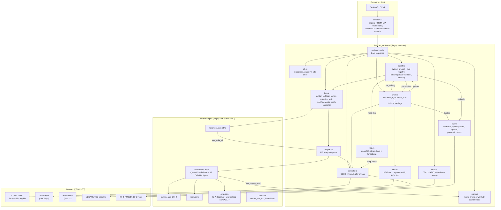
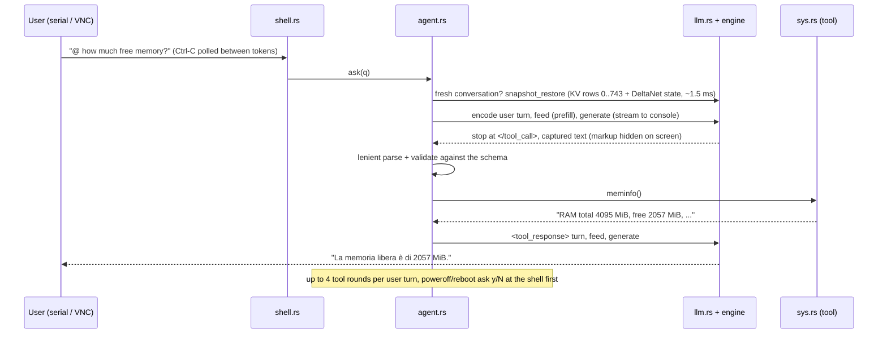

# AIOS architecture (as of M2+M3)

## Diagram



Data flow of `@ how much free memory?`:



Legend:

- **Boot**: Limine loads the kernel and the 1.9 GiB model as a module. `kmain` brings up the IDT, memory,
  SMP (APs enter the asm worker loop), checks the engine ABI, runs the golden self-test and the bench, then
  `agent::init` prefills the system prompt + tool list once (743 tokens, about 15 s) and snapshots the
  engine state. Then `shell::run`.
- **Shell**: one line = one builtin; `@ <text>` goes to the agent. Input from COM1 and PS/2 is polled into
  a type-ahead ring; 0x03 / Ctrl+C sets a flag that `llm::feed` and `llm::generate` check between tokens.
- **Agent**: Qwen3.5 native tool format (JSON tool lines in the system turn, `<tool_call><function=..>`
  calls, `<tool_response>` results in a user turn). The tokenizer splits special tokens and applies the
  Qwen pre-tokenizer regex before the engine BPE, so the prefix ids equal the HF tokenizer's
  (`tools/hf_prefix.py`, FNV hash printed at boot).
- **Prefix snapshot**: KV cache rows `0..P` of the 6 full-attention layers (head-major layout) plus the
  DeltaNet recurrent and conv state (36 MiB in the arena). `clear` marks the conversation fresh; the next
  `@` restores it instead of prefilling again. Multi-turn keeps the live state.
- **Log**: `klog!` prints and records `[sec.ms] L text` (I info, W warn, E error, A agent) in a 256-line
  ring, read by `log` and by the `read_log` tool.
- **Keyboard**: scancode set 1, layouts as data (`us`, `it` default), Shift, Ctrl, AltGr (E0 38, and left
  Alt for macOS VNC clients). `kbd` builtin or `set_setting keyboard`.

## Boot flow

1. Firmware (SeaBIOS or UEFI/OVMF) starts Limine from the ISO (El Torito: `limine-bios-cd.bin`
   for BIOS, `limine-uefi-cd.bin` / `BOOTX64.EFI` for UEFI).
2. Limine reads `limine.conf`, loads `/boot/kernel` (ELF, linked at `0xffffffff80000000`) and
   `/boot/model.asmbin` as a module, sets a GOP/VBE framebuffer, builds 4-level paging with the
   HHDM (base revision 3), starts every AP and parks it, then jumps to `kmain` on the BSP in
   long mode with a Limine stack. The IDT is undefined at this point.
3. `kmain` (kernel/src/main.rs): console on COM1 + framebuffer, IDT, CPUID check, `enable_avx_fpu`,
   TSC calibration (PIT ch2), arena + model identity maps, AP release, `model_init`, golden
   self-test, bench, agent prefix prefill + snapshot (kernel/src/agent.rs), then the shell
   (kernel/src/shell.rs).

## Memory

- Kernel image: higher half, 3 PT_LOAD segments (RX text, R rodata, RW data+bss). The engine's
  `.text/.rodata/.bss` (incl. `g_ctx`) are part of these segments. Engine objects are
  PC32-relative only, so they link at any address within +-2 GiB of their callers.
- Physical memory is reached through the HHDM (`phys + hhdm_offset`). In base revision 3 the
  HHDM covers usable, bootloader, kernel/module and framebuffer regions only; MMIO
  (LAPIC, IOAPIC, PCI BARs) must be mapped by us.
- The model is a Limine module: physically contiguous, already in RAM, mapped in the HHDM.
  `model_init` (M1) gets its HHDM virtual address. With `-m 4G` on q35 the model lands below
  4 GiB and 2 GiB of usable RAM remain above 4 GiB (`0x100000000`), which is where the
  engine's arena (`sys_mmap_anon`) will come from.
- The engine treats a negative `sys_mmap_anon` result as an error (transformer.asm:529), and HHDM
  addresses are negative. So the arena (largest usable region, bump allocator, kernel/src/mem.rs) and
  the model are **identity-mapped in the lower half with 2 MiB pages**, added to Limine's page tables
  before the APs start (they share CR3). `model_init` gets the model's physical (= identity) address.
- No heap and no general frame allocator yet.

## Where the engine sits

```
Rust kernel (ring 0, soft-float)          NASM engine (ring 0, AVX2/FMA/F16C)
  kmain ---- calls ---------------------->  silu_mul_avx2, argmax_f32 (M0 self-test)
                                             model_init, transformer_forward, tok_* (M1)
  sys_mmap_anon / sys_munmap   <-- imports -- transformer.asm   (mem.rs)
  sys_write_all / str_len      <-- imports -- tokenizer.asm     (engine.rs)
  tp_matmul_q8_0 / tp_gqa_attn /
  tp_deltanet                  <-- imports -- transformer.asm   (engine/smp.asm)
```

## SMP

Limine MP (x2APIC requested) starts every AP. `smp::start` writes `tid` into each AP's
`extra_argument` and its `goto_address` = `ap_limine_entry` (engine/smp.asm): own 64 KiB stack,
`ap_init` (lidt, LAPIC enable), `enable_avx_fpu`, then the asm OS worker loop. The BSP is tid 0 and
runs its own slice inside `tp_*`, so `transformer_forward` is called from the BSP only.

Idle workers spin for `tp_park_tsc` cycles, then, if `tp_park_enable`, count themselves in
`tp_n_parked` and `hlt`. A dispatcher that sees `tp_n_parked != 0` sends one broadcast IPI (vector
0xF0, EOI-only handler). Default policy: parking disabled during a generation, enabled between
requests (parking inside a generation costs 27-46% decode, see M1_RESULT.md). The BSP waits for input
in `hlt` with a 1 kHz TSC-deadline timer (vector 0xF1).

Interrupts stay off (IF=0) everywhere except inside those `sti; hlt` windows, so the engine is never
interrupted and the soft-float Rust handlers never need to save vector state.

The Rust target is soft-float, so Rust never touches xmm/ymm and the engine owns the vector
state. Consequence: engine functions that take float args in xmm registers need a small asm shim
before Rust can call them. `enable_avx_fpu` must run on every core that executes engine code.

## Still asm vs Rust

| Part | Language |
|---|---|
| Inference engine (math, matmul, tokenizer, transformer), vendored unmodified | NASM |
| `enable_avx_fpu` (engine/cpu.asm, from the old boot.asm) | NASM |
| Boot, paging, AP startup | Limine |
| `sample_top_p_bits` float shim (engine/cpu.asm) | NASM |
| SMP dispatch (`tp_*`), worker loop, AP entry, parking (engine/smp.asm, adapted from the asm OS) | NASM |
| Console, IDT, CPU checks, TSC calibration, memory maps, AP release, generation loop | Rust |
| Shell, keyboard layouts, kernel log, agent (prompt, tools, parser, loop), tokenizer pre-split, prefix snapshot | Rust |
