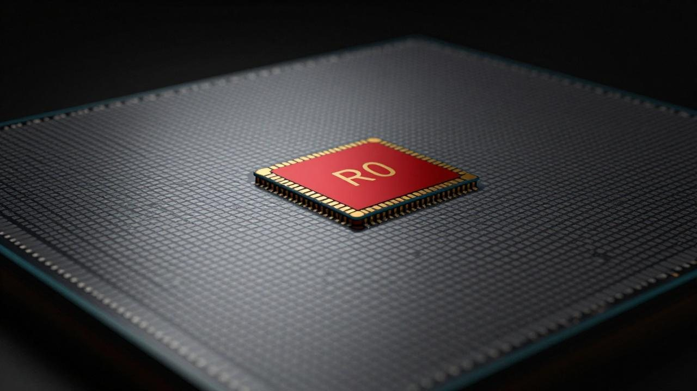

# ringzero beta images

Bootable images of [ringzero](https://github.com/tcsenpai/ringzero), an experimental x86-64 operating system
where a language model (Qwen3.5) and an embedding model (Qwen3-Embedding-0.6B) run in ring 0 on one inference
engine written in assembly. Website: https://tcsenpai.github.io/ringzero-site/

These are disk images for QEMU/KVM, not model weights in a standard format: each ISO contains the kernel, the
Limine bootloader and the converted weights of both models.

## Files

| File | Edition | Guest RAM |
|---|---|---|
| `ringzero-0.1.1-4b-q4.iso` | Qwen3.5-4B (Q4 MLP, Q8 attention) + Qwen3-Embedding-0.6B, recommended | 8 GB |
| `ringzero-0.1.1-2b-q8.iso` | Qwen3.5-2B Q8 + Qwen3-Embedding-0.6B, smaller and faster | 6 GB |
| `SHA256SUMS` | checksums of the 0.1.1 files | |

Current release: 0.1.1 "QweQwe" (beta). The 0.1.0 images (`ringzero-beta-*.iso`) stay in this repository; their
checksums are on the GitHub release v0.1.0-beta.

The data disk with the preinstalled programs (python3, sqlite3, jq, lua, QuickJS, ripgrep, coreutils, an
editor) is on the GitHub release page of the repository
(v0.1.1, `ringzero-0.1.1-disk.img.xz`).

## Run

See `docs/BETA.md` in the repository for requirements and the exact QEMU command lines. The CPU needs AVX2, FMA
and F16C.

## Licenses

- ringzero kernel and tools: GPL-2.0-or-later.
- Inference engine: [llm.asm](https://github.com/alesha-pro/llm.asm) by alesha-pro, MIT.
- Limine bootloader: BSD-2-Clause.
- Model weights: Qwen3.5-4B, Qwen3.5-2B and Qwen3-Embedding-0.6B by the Qwen team, Apache-2.0, converted to the
  engine's format. See LICENSE.md.
